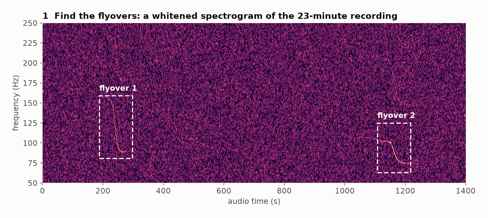
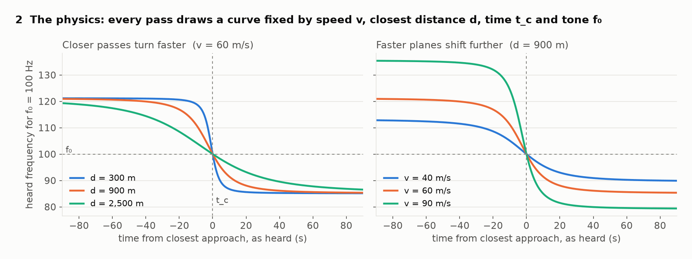
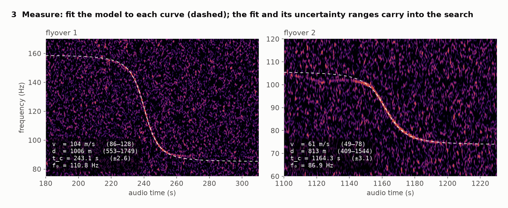
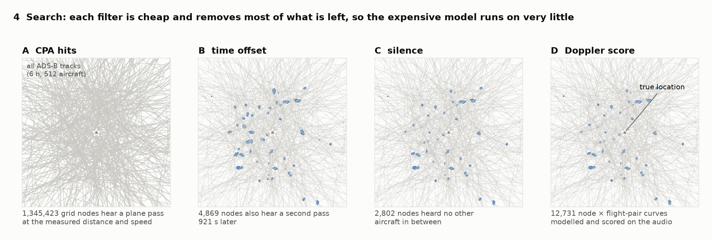
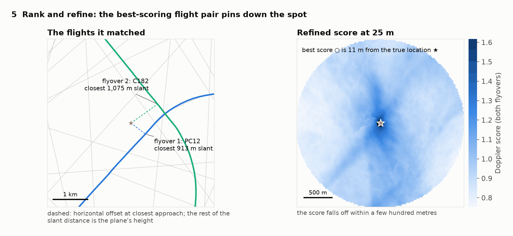

# audio2loc

audio2loc finds where an audio or video recording was made from the Doppler curves of propeller
aircraft heard in it. You box each flyover's tone on a spectrogram, and audio2loc fits its speed,
closest-approach distance and time. It then searches a day of historical ADS-B tracks from
[adsb.lol](https://adsb.lol) for the spot on the ground that would have heard exactly those curves.
It reimplements the method from colsto's *"I discovered a sound that leaks your exact location"*
([video](https://youtube.com/watch?v=UytYrhYLOKI)) as a C++20 command-line tool. Results are ranked
coordinates, GeoJSON layers and a QGIS project. It runs on the CPU and, optionally, an NVIDIA GPU.

You need at least a minute of a clearly audible piston or turboprop flyover, ideally two, and the
date. Uploads to messengers and social media keep the audio but strip the date and location
metadata, so audio2loc works on those copies too. Use it to verify or investigate material whose
subject consents or that is of public interest, not to find private individuals.
[docs/guide.md](docs/guide.md) covers the method, every option and the benchmarks.

## How it works

These figures come from a run on a simulated recording (`audio2loc simulate --seed 7`): 6 hours
of traffic over Long Island, 23 minutes of audio, and a hidden observer that the search has to find.
`tools/explainer_figures.py` redraws them from audio2loc's own outputs.

**1. Find the flyovers.** A plane's propeller and engine hum at a steady pitch, so a flyover leaves
a falling S-curve on a spectrogram, often quieter than you can hear. audio2loc whitens the
spectrogram, normalizing each frequency against its own noise floor, so faint curves stand out.
You draw a box around one tone of each flyover.

<picture>
  <source media="(prefers-color-scheme: dark)" srcset="docs/images/01-spectrogram-dark.png">
  
</picture>

**2. The physics.** The pitch you hear is the tone f₀ shifted by how fast the plane is closing on
you. The pitch falls through f₀ at the moment of closest approach, t_c. How far it moves depends on
the speed v, and how sharply it turns depends on the closest distance d. Sound takes seconds to
arrive, so the model evaluates the plane's velocity when the sound was *emitted*, not when it was
heard. Using the time it was heard gives a different, wrong curve.

<picture>
  <source media="(prefers-color-scheme: dark)" srcset="docs/images/02-doppler-model-dark.png">
  
</picture>

**3. Measure.** audio2loc traces the ridge of each curve and fits the straight-line model, which
gives speed, distance, time and tone, each with a generous uncertainty range. Two flyovers also fix
the time between them (921 s here). Flyover 2 was turning, so the straight-line fit misses its
start; that's fine, because the fit only bounds the search, and step 4 uses the real track.

<picture>
  <source media="(prefers-color-scheme: dark)" srcset="docs/images/03-measure-dark.png">
  
</picture>

**4. Search.** Every ADS-B track in the time window is a suspect. Stages A–C are cheap geometric
tests on a 200 m grid. A keeps ground points that a plane passed at the measured distance and speed.
B keeps those that also heard a second pass at the right offset. C drops points where another
aircraft would have been audible in between. Only then does D compute, for each surviving point and
flight pair, the exact curve that point would have heard from the real trajectory. It scores that
curve against the spectrogram, harmonics included.

<picture>
  <source media="(prefers-color-scheme: dark)" srcset="docs/images/04-search-dark.png">
  
</picture>

**5. Rank and refine.** The best-scoring flight pair wins, and a dense 25 m score map around it
gives the final answer. Here that answer is 11 m from the hidden observer. Against a full day of
real ADS-B traffic over California, with a simulated recording, it lands 39 m from the truth.
Outputs are ranked coordinates, GeoJSON for every stage and a QGIS project.

<picture>
  <source media="(prefers-color-scheme: dark)" srcset="docs/images/05-result-dark.png">
  
</picture>

## Build

```sh
cmake -S . -B build -DCMAKE_BUILD_TYPE=Release   # needs CMake 3.24+, a C++20 compiler, zlib
cmake --build build -j
ctest --test-dir build                           # includes a synthetic end-to-end locate
build/audio2loc --help
```

Add `-DAUDIO2LOC_CUDA=ON` for the GPU path, which falls back to the CPU if there's no GPU, and
`-DAUDIO2LOC_NATIVE=ON` to tune for your CPU. `ffmpeg` decodes video and compressed audio.
To try the pipeline without real data:

```sh
build/audio2loc simulate --prefix sim --seed 7        # synthetic flights and audio, hidden observer
build/audio2loc $(grep ^suggested: sim_truth.txt | cut -d' ' -f3-)
```

## MCP server

`audio2loc mcp` is a Model Context Protocol server on stdio. Its tools are `spectrogram`,
`measure_doppler`, `locate`, `update_database` and `database_status`, so an AI agent can run the
whole workflow and download ADS-B days as needed. With Claude Code:

```sh
claude mcp add audio2loc -- $PWD/build/audio2loc mcp --work $HOME/audio2loc/work --db $HOME/audio2loc/db
```

Or with Docker, which also bundles ffmpeg and yt-dlp, so the tools accept URLs:

```sh
docker build -t audio2loc .                                       # or --target cuda
claude mcp add audio2loc -- docker run --rm -i -v audio2loc-db:/data -v "$PWD":/work audio2loc
```

Other clients take the same command as JSON:

```json
{ "mcpServers": { "audio2loc": { "command": "/path/to/audio2loc", "args": ["mcp", "--db", "/path/to/db"] } } }
```
